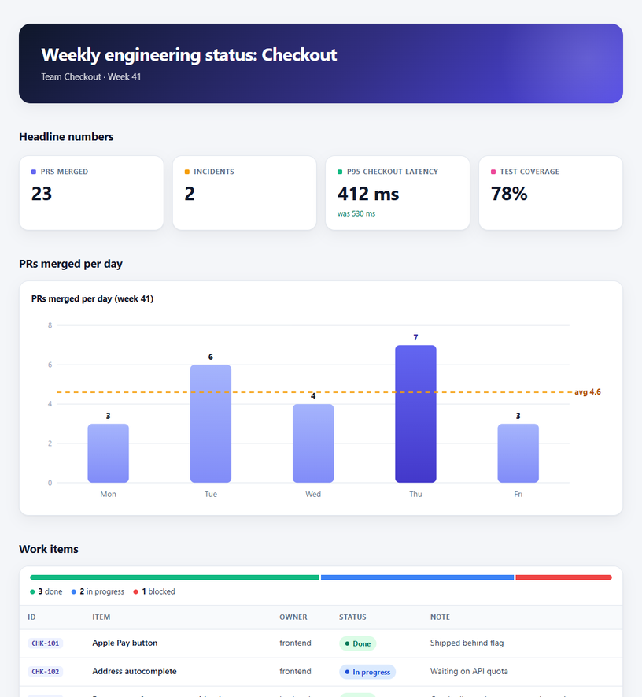
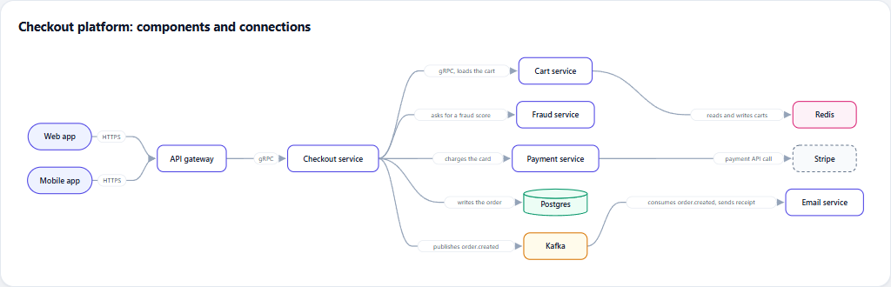
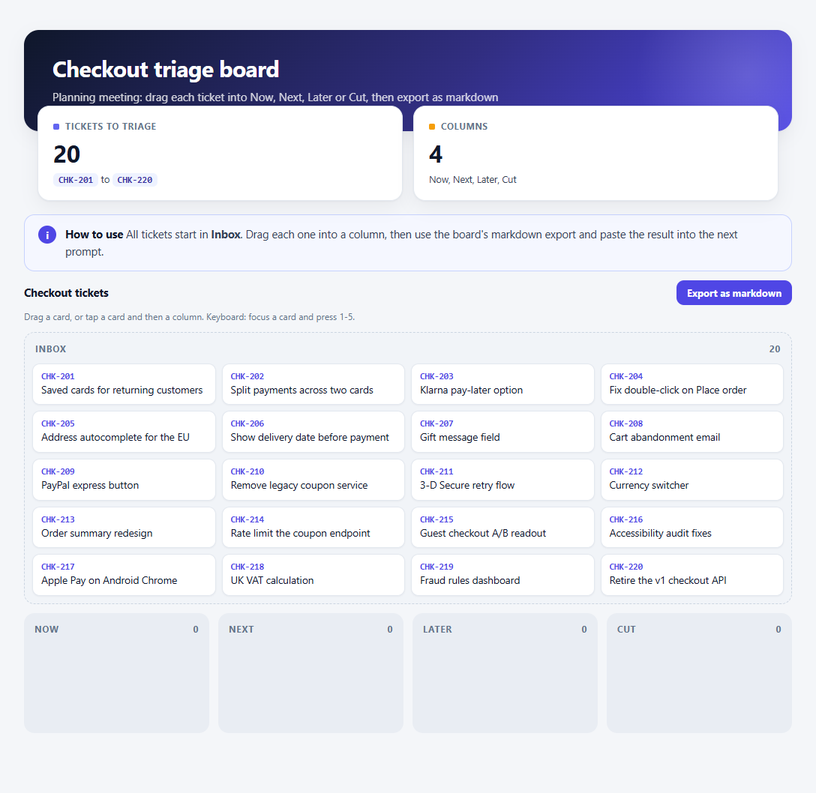

# agent-html-kit

HTML pages from a coding agent at markdown token cost.

> [!NOTE]
> **A demo, not a product.** This repo shows the approach behind the benchmark: move the
> design into one file, and let the agent write only content. It is here to learn from and
> to reproduce the numbers. It is not a finished, production-ready library: the kit covers
> a few components, has no tests, and has only been tried on the pages in `examples/`.
> Copy the idea, adapt the code to your own documents, and expect to fix things.

When an agent writes a freeform HTML page, most of the tokens go into design: CSS,
hand-placed SVG coordinates, and JavaScript the page doesn't need. This kit moves all of
that into one script file (`kit/kit.js`). The agent writes only content, using a few
components, so an HTML report costs about the same as the markdown version.

The repo also contains the benchmark behind that claim: 72 real Claude Code runs,
every number taken from `claude -p --output-format json` usage receipts.



Background: Thariq from the Claude Code team makes the case for HTML over markdown as agent
output in [Using Claude Code: The Unreasonable Effectiveness of HTML](https://claude.com/blog/using-claude-code-the-unreasonable-effectiveness-of-html).
This repo measures what that costs in tokens, and how to keep the HTML without paying for it.

## Results

Model `claude-opus-5-5` in Claude Code 2.1.296, 3 runs per cell, median shown. Run on
2026-10-12. Each call ran in an empty temp folder with settings files off
(`--setting-sources ""`), no MCP servers, skills or slash commands, and only the tools the
job needs. Claude Code's built-in plugins and agents stayed loaded, the same for every format.

**Output tokens per job**

| Job | A · markdown | B · freeform HTML | C · HTML + kit | D · markdown + renderer |
|---|---:|---:|---:|---:|
| Weekly status report | 883 | 7,204 | 726 | 569 |
| Architecture diagram | 1,672 | 17,314 | 1,015 | 1,651 |
| Drag-and-drop triage board | 790 | 16,987 | 615 | 698 |
| Implementation plan | 8,599 | 25,376 | 8,911 | 9,086 |

Output tokens include thinking. Without it the gap stays or widens: the report is 707 vs
6,782 artifact tokens, the board 432 vs 10,848. Markdown cannot drag cards, so the A board
is a static list. The closer board comparison is B vs C, 16,987 vs 615 output tokens for the
same task (drag tickets into columns, export as markdown). Not an identical feature set:
the freeform boards also added extras such as saved state and reset buttons, which is part
of what freeform costs.

**API time per job (seconds)**

| Job | A | B | C | D |
|---|---:|---:|---:|---:|
| Report | 7.5 | 55.5 | 5.9 | 4.9 |
| Diagram | 14.5 | 143.6 | 8.2 | 15.2 |
| Board | 7.9 | 136.7 | 5.1 | 6.2 |
| Plan | 70.2 | 197.8 | 74.3 | 77.0 |

**A second agent builds a module from each plan** (19 hidden tests it never sees)

| Plan format | Tests passed (3 runs) | Input tokens | Cost (USD, list price) |
|---|---|---:|---:|
| A · markdown | 19, 19, 19 | 85,954 | 0.126 |
| B · freeform HTML | 19, 19, 19 | 234,403 | 0.209 |
| C · HTML + kit | 19, 19, 19 | 83,887 | 0.092 |
| D · markdown + renderer | 19, 19, 19 | 66,500 | 0.077 |

Every build passed the test suite. The freeform HTML plan cost about two thirds more: the
bigger plan stays in the context of every later request (mostly as cache reads), and turn
counts differ between runs too. The 19 tests cover the spec's main rules, not every edge:
two builds (B-1, C-2) raise an error for an empty cart with an unknown coupon where the
other ten return zeros, and no test checks that case.

**One small edit** ("CHK-102 is now done, update everything that depends on it"):
all 12 edits were correct (checked by hand from the diffs; the outputs are in
`bench/results/edit/`). In the kit version the diff is two lines; in the freeform
version the same fact lives in six places (progress bar widths, legend, filter counts,
the row's status pill, its note, next week).

Full numbers: `bench/results/summary.json`. Generated files for every run sit next to
their receipts in `bench/results/<job>/`, exactly as the agent wrote them. The kit pages
there load `kit/kit.js` from their own folder, so to view one, copy `kit/` next to it or
open the copies in `examples/`.

## Use the kit

Copy `kit/` next to your documents. An HTML document starts with one line, then content:

```html
<!doctype html><meta charset="utf-8"><script src="kit/kit.js" defer></script>
<rk-header title="Weekly Engineering Status" sub="Team Checkout, week 41"></rk-header>
<rk-stats>
23 | PRs merged | +5 vs last week
</rk-stats>
<rk-chart type="bar" title="PRs merged per day">
Mon: 3
Tue: 6
</rk-chart>
```

Components: `rk-header`, `rk-stats`, `rk-chart`, `rk-table`, `rk-callout`,
`rk-diagram`, `rk-steps`, `rk-board`, `rk-cols`. In any text, `**bold**`, `` `code` ``,
`[done]`-style status pills and ticket IDs like `CHK-101` are formatted. The full contract
the agent gets is `bench/contracts/html.txt` (634 input tokens per call). Examples are in
`examples/`; open them in a browser.



The board is a real drag-and-drop page with a markdown export. On a touch screen, tap a
card and then a column; with a keyboard, focus a card and press the column's number.



Prefer markdown? Write it with the fenced `chart`, `diagram`, `steps` and `board`
blocks and render it:

```bash
node kit/md2html.js report.md          # -> report.html with kit components
node kit/md2html.js report.md --plain  # -> same markdown, plain GitHub-like look
```

The renderer covers the markdown agents write (headings, nested lists, task lists, tables,
code, quotes, links, images). It is not a full CommonMark implementation.

## Claude Code skill

`skill/SKILL.md` teaches the agent the kit contract. Install it together with the kit, so
the agent can copy `kit/` next to the documents it writes:

```bash
mkdir -p .claude/skills/html-kit                 # or ~/.claude/skills/html-kit
cp skill/SKILL.md .claude/skills/html-kit/
cp -R kit .claude/skills/html-kit/
```

## Run the benchmark yourself

Needs the Claude Code CLI and Python 3. The full run is 72 task runs plus 20 short
token-counting calls (more if a call is retried), and it uses real tokens on your account.

```bash
bash bench/run_all.sh                     # everything, into bench/results-local
AHK_RESULTS=bench/results-mine python3 bench/run.py gen --scenario report --runs 3  # one job
AHK_RESULTS=bench/results-mine python3 bench/run.py summary                         # its summary
```

A run never writes into the committed `bench/results`. Receipts already in the target
folder are skipped, so an interrupted run picks up where it stopped. Your numbers will
differ from ours; model, Claude Code version and day all move them.

## Limits

- One model (Opus 5.5) and three runs per cell. Treat the numbers as directional.
- The freeform prompt (B) asks for a polished page: inline CSS, real SVG, JavaScript
  where interaction is needed. A terser freeform prompt would cost less; that was not
  measured.
- Dollar amounts are list prices from the receipts (`costBasis: "list"`). On a
  subscription you pay in usage limits instead.
- Writing a kit is not free. `kit/kit.js` measured 20,564 tokens in the benchmark (v1.0;
  the v1.1 fixes make the file about 12% larger). That is the size of the file, not what
  it took to develop it. Each kit report saves about 6,478 output tokens against a
  freeform one (726 vs 7,204), so the kit file pays for itself by the fourth report.
- The kit only knows its components. A page that needs something it doesn't have
  costs the freeform price.
- Pages need JavaScript to render. Links and images in kit text accept only http(s),
  mailto and relative URLs, but a page still runs whatever HTML it contains: open pages
  you or your agent wrote, not untrusted ones.
- Raw `claude -p` event streams are not committed (they contain local paths and
  session ids). One build reply in `bench/results/implement/B-2.json` had a local
  temp path, redacted to `%TEMP%`.

## Changes

- **v1.1** (after a review, including an independent one by a second model):
  - Plain `<p>`/`<li>`/callout text gets the same formatting as components (`**bold**` and
    `` `code` `` showed raw in v1.0); code spans stay literal.
  - Security: chart `unit` is escaped (v1.0 let markup through); `javascript:` and other
    non-web links are dropped; formatting no longer runs inside link targets.
  - Charts show values as written (0.126 showed as 0.1), read `1e3`, and refuse negative
    values with a visible note instead of drawing them wrong. Axis ticks stay round.
  - Flowchart labels no longer slide off the left edge.
  - Markdown: `~~strike~~`, images, nested lists, h5/h6. UTF-8, SHA-256 & co. are no longer
    styled as ticket IDs.
  - Phones: tables and diagrams scroll, board columns wrap; the board works by touch and
    keyboard.
  - `md2html.js` encodes the script path; the benchmark writes fresh runs to their own
    folder and `run_all.sh` works on macOS/Linux.

  Rendering and tooling only: the benchmark numbers are unchanged.
- **v1.0**: the version measured in the benchmark (tag `v1.0`).

## License

MIT
