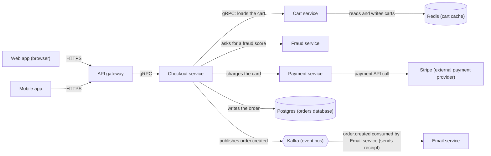

# Checkout Platform: Architecture Overview

This document gives new engineers a map of the checkout platform: what the components are, how they connect, and what happens during a single checkout.

## Components

| Component | Role |
| --- | --- |
| Web app | Browser client |
| Mobile app | Mobile client |
| API gateway | Entry point for client traffic |
| Checkout service | Coordinates the checkout |
| Cart service | Owns carts |
| Payment service | Charges the card |
| Fraud service | Provides a fraud score |
| Postgres | Orders database |
| Redis | Cart cache |
| Kafka | Event bus |
| Stripe | External payment provider |
| Email service | Sends receipts |

## Diagram

## Connections

| From | To | Description |
| --- | --- | --- |
| Web app | API gateway | HTTPS |
| Mobile app | API gateway | HTTPS |
| API gateway | Checkout service | gRPC |
| Checkout service | Cart service | gRPC, loads the cart |
| Cart service | Redis | Reads and writes carts |
| Checkout service | Fraud service | Asks for a fraud score |
| Checkout service | Payment service | Charges the card |
| Payment service | Stripe | Payment API call |
| Checkout service | Postgres | Writes the order |
| Checkout service | Kafka | Publishes `order.created` |
| Kafka | Email service | Email service consumes `order.created` and sends the receipt |

## Walkthrough: One Checkout

1. **Request arrives.** The customer checks out from the Web app or the Mobile app. The client calls the API gateway over HTTPS.
2. **Gateway forwards.** The API gateway calls the Checkout service over gRPC.
3. **Cart is loaded.** The Checkout service calls the Cart service over gRPC to load the cart. The Cart service reads carts from Redis.
4. **Fraud check.** The Checkout service asks the Fraud service for a fraud score.
5. **Payment.** The Checkout service asks the Payment service to charge the card. The Payment service makes a payment API call to Stripe.
6. **Order is written.** The Checkout service writes the order to Postgres. **Rule:** the order is only written after the fraud score passes *and* the charge succeeds.
7. **Event is published.** The Checkout service publishes `order.created` to Kafka.
8. **Receipt is sent.** The Email service consumes `order.created` from Kafka and sends the receipt.

> **Not covered by this overview:** the relative order of the fraud check and the charge, the behavior when the fraud score fails or the charge does not succeed, and the timing of the `order.created` publish relative to the order write. The source material does not specify these.