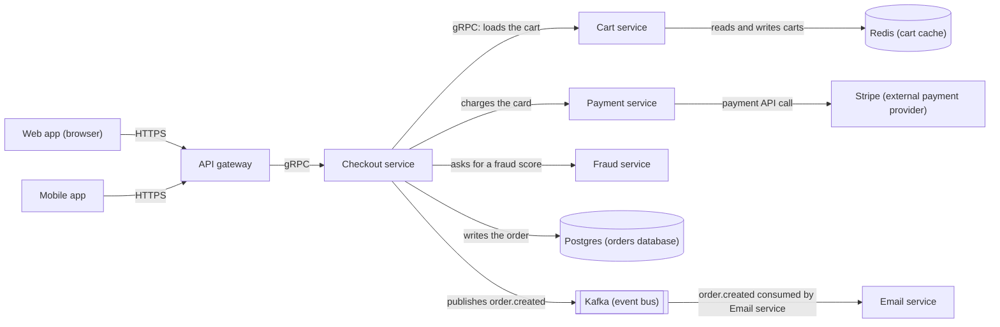

# Checkout Platform: Architecture Overview

This document is for engineers new to the checkout platform. It lists the platform's components, shows how they connect, and walks through what happens during a single checkout.

## Components

| Component | Role |
| --- | --- |
| Web app | Browser client |
| Mobile app | Mobile client |
| API gateway | Entry point for client traffic |
| Checkout service | Coordinates checkout |
| Cart service | Loads, reads and writes carts |
| Payment service | Charges the card |
| Fraud service | Provides a fraud score |
| Postgres | Orders database |
| Redis | Cart cache |
| Kafka | Event bus |
| Stripe | External payment provider |
| Email service | Sends the receipt |

## Diagram

## Connections

| From | To | Description |
| --- | --- | --- |
| Web app | API gateway | HTTPS |
| Mobile app | API gateway | HTTPS |
| API gateway | Checkout service | gRPC |
| Checkout service | Cart service | gRPC, loads the cart |
| Cart service | Redis | Reads and writes carts |
| Checkout service | Fraud service | Asks for a fraud score |
| Checkout service | Payment service | Charges the card |
| Payment service | Stripe | Payment API call |
| Checkout service | Postgres | Writes the order |
| Checkout service | Kafka | Publishes `order.created` |
| Kafka | Email service | Email service consumes `order.created` and sends the receipt |

## Walkthrough: One Checkout

1. **Request arrives.** The customer checks out from the Web app or the Mobile app. The client sends the request to the API gateway over HTTPS.
2. **Gateway forwards.** The API gateway forwards the request to the Checkout service over gRPC.
3. **Cart is loaded.** The Checkout service calls the Cart service over gRPC to load the cart. The Cart service reads the cart from Redis.
4. **Fraud check.** The Checkout service asks the Fraud service for a fraud score.
5. **Card is charged.** The Checkout service asks the Payment service to charge the card. The Payment service makes a payment API call to Stripe.
6. **Order is written.** The Checkout service writes the order to Postgres. **Rule:** an order is only written after the fraud score passes and the charge succeeds. If either one fails, no order is written.
7. **Event is published.** The Checkout service publishes `order.created` to Kafka.
8. **Receipt is sent.** The Email service consumes `order.created` from Kafka and sends the receipt.