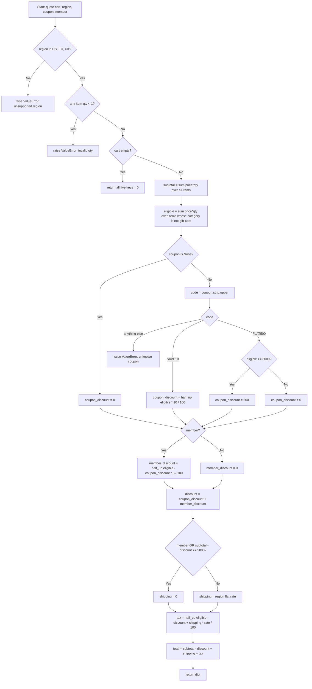

# Implementation Plan: `pricing.py`

## 1. Goal

Create a Python module `pricing.py` that exposes one public function:

```python
quote(cart, region, coupon=None, member=False) -> dict
```

The function prices a shopping cart. It returns a dict with **exactly** these five keys, all `int`, all in cents:

| Key | Meaning |
|---|---|
| `subtotal` | Sum of `price * qty` over all items, gift cards included |
| `discount` | Coupon discount + member discount |
| `shipping` | Shipping charge |
| `tax` | Tax charged |
| `total` | `subtotal - discount + shipping + tax` |

All money is integer cents, both as input and as output. Floats must never appear in the calculation.

## 2. Inputs

| Parameter | Type | Description |
|---|---|---|
| `cart` | `list[dict]` | List of items. May be empty. |
| `region` | `str` | Must be exactly `"US"`, `"EU"` or `"UK"` (case-sensitive). |
| `coupon` | `str` or `None` | Optional coupon code. `None` means no coupon. |
| `member` | `bool` | Whether the customer is a member. Default `False`. |

Each cart item is a dict:

| Key | Type | Description |
|---|---|---|
| `sku` | `str` | Item identifier. Not used in calculations. |
| `price` | `int` | Unit price in cents. |
| `qty` | `int` | Quantity. Must be at least 1. |
| `category` | `str` | Category. The value `"gift-card"` gets special treatment. |

## 3. Calculation Flow



## 4. Rules

### 4.1 Validation (runs first, before anything else)

Checks run in this order. The first failing check raises; later checks are not evaluated.

| Order | Condition | Action |
|---|---|---|
| 1 | `region` is not one of `"US"`, `"EU"`, `"UK"` (exact, case-sensitive match) | `raise ValueError("unsupported region")` |
| 2 | Any item in `cart` has `qty < 1` (0 or negative) | `raise ValueError("invalid qty")` |

Notes:
- Region validation happens even when the cart is empty. For example, `quote([], "CA")` raises `"unsupported region"`.
- If both region and qty are invalid, the region error wins.
- The error messages must match exactly: `"unsupported region"`, `"invalid qty"`, `"unknown coupon"`.

### 4.2 Empty cart

| Condition | Result |
|---|---|
| After validation passes, `cart == []` | Return `{"subtotal": 0, "discount": 0, "shipping": 0, "tax": 0, "total": 0}` immediately |

Because the early return happens before coupon handling, an empty cart with an unknown coupon returns all zeros and does **not** raise `"unknown coupon"`. This follows the requirement order: validation is region + qty only, then the empty cart returns zeros. See Open Questions (§8).

### 4.3 Subtotal and eligible amount

| Value | Definition |
|---|---|
| `subtotal` | Σ `price * qty` over **all** items |
| `eligible` | Σ `price * qty` over items where `category != "gift-card"` |

Gift cards count toward `subtotal` (and so toward the free-shipping threshold). They are never discounted and never taxed. Only `eligible` is used for discounts and tax.

### 4.4 Coupons

First normalise the code: `code = coupon.strip().upper()`. Codes are case-insensitive, and leading or trailing whitespace is ignored.

| Normalised code | Coupon discount |
|---|---|
| (`coupon is None`) | `0` |
| `"SAVE10"` | `half_up(eligible * 10 / 100)` |
| `"FLAT500"` and `eligible >= 3000` | `500` |
| `"FLAT500"` and `eligible < 3000` | `0` (not an error) |
| anything else, including `""` or whitespace-only | `raise ValueError("unknown coupon")` |

The FLAT500 threshold is **inclusive**: exactly 3000 qualifies. The threshold is measured on `eligible`, not on `subtotal`.

### 4.5 Member discount

| `member` | Member discount |
|---|---|
| `True` | `half_up((eligible - coupon_discount) * 5 / 100)` |
| `False` | `0` |

The member discount is applied after the coupon, on the eligible amount minus the coupon discount. The two discounts are summed:

`discount = coupon_discount + member_discount`

Only the combined `discount` is returned. Each component is rounded separately, at the moment it is computed.

### 4.6 Shipping

Evaluate the rows top to bottom. The first matching row wins.

| Condition | Shipping |
|---|---|
| `member` is `True` | `0` |
| `subtotal - discount >= 5000` (inclusive) | `0` |
| otherwise, region `"US"` | `599` |
| otherwise, region `"EU"` | `899` |
| otherwise, region `"UK"` | `899` |

The free-shipping threshold uses `subtotal`, which includes gift cards, not `eligible`.

### 4.7 Tax

`tax_base = eligible - discount + shipping`

`tax = half_up(tax_base * rate / 100)`

| Region | Rate (percent) |
|---|---|
| `"US"` | 7 |
| `"EU"` | 20 |
| `"UK"` | 20 |

Gift-card value is never part of `tax_base`. Shipping is taxed.

### 4.8 Total

`total = subtotal - discount + shipping + tax`

### 4.9 Rounding

Every percentage result is rounded **half up** to a whole cent at the moment it is computed. This applies to exactly three values:
1. the SAVE10 discount
2. the member discount
3. the tax

Do **not** use Python's `round()`. It uses banker's rounding: `round(80.5) == 80`, but the required result is 81. Do not use floats either.

Implement a private integer helper:

`_pct_half_up(amount, percent) = (amount * percent + 50) // 100`

All inputs to this helper are non-negative integers:
- `eligible ≥ 0`
- `eligible - coupon_discount ≥ 0`, because SAVE10 takes only 10% and FLAT500 applies only when eligible ≥ 3000
- `tax_base ≥ 0`

So floor division with a `+50` offset gives correct half-up rounding.

| Exact value | Half up (required) | Python `round()` (wrong) |
|---|---|---|
| 80.5 | 81 | 80 |
| 100.5 | 101 | 100 |
| 50.5 | 51 | 50 |
| 73.5 | 74 | 74 |
| 779.6 | 780 | 780 |
| 181.93 | 182 | 182 |

## 5. Implementation Steps

1. **Create `pricing.py`** with module-level constants:
   - `REGIONS = {"US", "EU", "UK"}`
   - `SHIPPING_RATES = {"US": 599, "EU": 899, "UK": 899}`
   - `TAX_RATES = {"US": 7, "EU": 20, "UK": 20}` (whole percent)
   - `FREE_SHIPPING_THRESHOLD = 5000`
   - `FLAT500_MIN_ELIGIBLE = 3000`
   - `FLAT500_AMOUNT = 500`
   - `SAVE10_PERCENT = 10`
   - `MEMBER_PERCENT = 5`
   - `GIFT_CARD = "gift-card"`
2. **Add the helper** `_pct_half_up(amount: int, percent: int) -> int` returning `(amount * percent + 50) // 100`.
3. **Define `quote(cart, region, coupon=None, member=False)`.**
4. **Validate region:** if `region not in REGIONS`, raise `ValueError("unsupported region")`.
5. **Validate quantities:** if any `item["qty"] < 1`, raise `ValueError("invalid qty")`.
6. **Handle the empty cart:** if `not cart`, return the five keys, all `0`.
7. **Compute `subtotal` and `eligible`** in one pass over the cart (§4.3).
8. **Compute `coupon_discount`** (§4.4):
   - If `coupon is None`, it is `0`.
   - Otherwise normalise with `.strip().upper()` and branch on the code.
   - Unknown codes raise `ValueError("unknown coupon")`.
9. **Compute `member_discount`** (§4.5) using `_pct_half_up(eligible - coupon_discount, MEMBER_PERCENT)` when `member` is true.
10. **Compute `discount = coupon_discount + member_discount`.**
11. **Compute `shipping`** (§4.6).
12. **Compute `tax = _pct_half_up(eligible - discount + shipping, TAX_RATES[region])`** (§4.7).
13. **Compute `total`** (§4.8).
14. **Return** `{"subtotal": ..., "discount": ..., "shipping": ..., "tax": ..., "total": ...}`. Return exactly these five keys, all `int`, with no extra keys.
15. **Write tests** covering every worked example in §6 and every error case in §7.

## 6. Worked Examples (successful quotes)

Item shorthand: `(price, qty, category)`. The SKU is irrelevant.

### Example 1: Basic US, no coupon, non-member
- Cart: `(1000, 2, "general")`. Region `US`. No coupon. Non-member.

| Step | Calculation | Value |
|---|---|---|
| subtotal | 1000×2 | 2000 |
| eligible | | 2000 |
| coupon_discount | none | 0 |
| member_discount | non-member | 0 |
| discount | | 0 |
| shipping | 2000 − 0 < 5000, US | 599 |
| tax | (2000 − 0 + 599) × 7% = 181.93 | 182 |
| total | 2000 − 0 + 599 + 182 | **2781** |

Result: `{subtotal: 2000, discount: 0, shipping: 599, tax: 182, total: 2781}`

### Example 2: EU, SAVE10 + member, with a gift card
- Cart: `(2500, 2, "book")`, `(2000, 1, "gift-card")`. Region `EU`. Coupon `"SAVE10"`. Member.

| Step | Calculation | Value |
|---|---|---|
| subtotal | 5000 + 2000 | 7000 |
| eligible | gift card excluded | 5000 |
| coupon_discount | 5000 × 10% | 500 |
| member_discount | (5000 − 500) × 5% = 225 | 225 |
| discount | 500 + 225 | 725 |
| shipping | member | 0 |
| tax | (5000 − 725 + 0) × 20% = 855 | 855 |
| total | 7000 − 725 + 0 + 855 | **7130** |

Result: `{subtotal: 7000, discount: 725, shipping: 0, tax: 855, total: 7130}`

### Example 3: Tax rounding half up (80.5 → 81)
- Cart: `(551, 1, "general")`. Region `US`. No coupon. Non-member.

| Step | Calculation | Value |
|---|---|---|
| subtotal / eligible | | 551 / 551 |
| discount | | 0 |
| shipping | US | 599 |
| tax | 1150 × 7% = 80.5 → half up | 81 (`round()` would give 80) |
| total | 551 + 599 + 81 | **1231** |

Result: `{subtotal: 551, discount: 0, shipping: 599, tax: 81, total: 1231}`

### Example 4: SAVE10 rounding half up (100.5 → 101), mixed-case coupon
- Cart: `(1005, 1, "general")`. Region `EU`. Coupon `"save10"`. Non-member.

| Step | Calculation | Value |
|---|---|---|
| subtotal / eligible | | 1005 / 1005 |
| coupon_discount | 1005 × 10% = 100.5 → half up | 101 |
| discount | | 101 |
| shipping | 904 < 5000, EU | 899 |
| tax | (1005 − 101 + 899) = 1803 × 20% = 360.6 | 361 |
| total | 1005 − 101 + 899 + 361 | **2164** |

Result: `{subtotal: 1005, discount: 101, shipping: 899, tax: 361, total: 2164}`

### Example 5: Member discount rounding half up (50.5 → 51)
- Cart: `(1010, 1, "general")`. Region `US`. No coupon. Member.

| Step | Calculation | Value |
|---|---|---|
| subtotal / eligible | | 1010 / 1010 |
| member_discount | 1010 × 5% = 50.5 → half up | 51 |
| discount | | 51 |
| shipping | member | 0 |
| tax | 959 × 7% = 67.13 | 67 |
| total | 1010 − 51 + 0 + 67 | **1026** |

Result: `{subtotal: 1010, discount: 51, shipping: 0, tax: 67, total: 1026}`

### Example 6: FLAT500 below threshold gives nothing
- Cart: `(2999, 1, "general")`. Region `UK`. Coupon `"FLAT500"`. Non-member.

| Step | Calculation | Value |
|---|---|---|
| subtotal / eligible | | 2999 / 2999 |
| coupon_discount | 2999 < 3000 | 0 |
| shipping | UK | 899 |
| tax | (2999 + 899) = 3898 × 20% = 779.6 | 780 |
| total | 2999 + 899 + 780 | **4678** |

Result: `{subtotal: 2999, discount: 0, shipping: 899, tax: 780, total: 4678}`

### Example 7: FLAT500 at exactly 3000, whitespace + lowercase, member
- Cart: `(3000, 1, "toys")`. Region `UK`. Coupon `"  flat500 "`. Member.

| Step | Calculation | Value |
|---|---|---|
| subtotal / eligible | | 3000 / 3000 |
| coupon_discount | 3000 ≥ 3000 | 500 |
| member_discount | 2500 × 5% | 125 |
| discount | | 625 |
| shipping | member | 0 |
| tax | 2375 × 20% | 475 |
| total | 3000 − 625 + 0 + 475 | **2850** |

Result: `{subtotal: 3000, discount: 625, shipping: 0, tax: 475, total: 2850}`

### Example 8: Gift card pushes subtotal to the free-shipping threshold
- Cart: `(4000, 1, "gift-card")`, `(1000, 1, "general")`. Region `US`. No coupon. Non-member.

| Step | Calculation | Value |
|---|---|---|
| subtotal | 4000 + 1000 | 5000 |
| eligible | | 1000 |
| discount | | 0 |
| shipping | 5000 − 0 ≥ 5000 (inclusive) | 0 |
| tax | 1000 × 7% | 70 |
| total | 5000 + 0 + 70 | **5070** |

Result: `{subtotal: 5000, discount: 0, shipping: 0, tax: 70, total: 5070}`

### Example 9: Empty cart
- `quote([], "EU")` returns `{subtotal: 0, discount: 0, shipping: 0, tax: 0, total: 0}`.
- `quote([], "US", coupon="BOGUS")` returns all zeros, because the empty-cart return comes before coupon handling.

## 7. Error Examples

| Call | Result |
|---|---|
| `quote([...], "CA")` | `ValueError("unsupported region")` |
| `quote([...], "us")` | `ValueError("unsupported region")` (region is case-sensitive) |
| `quote([], "CA")` | `ValueError("unsupported region")` (validation runs before the empty-cart check) |
| `quote([(500, 0, "general")], "US")` | `ValueError("invalid qty")` |
| `quote([(500, -1, "general")], "US")` | `ValueError("invalid qty")` |
| `quote([(500, 0, "general")], "CA")` | `ValueError("unsupported region")` (region is checked first) |
| `quote([(500, 1, "general")], "US", coupon="SAVE20")` | `ValueError("unknown coupon")` |
| `quote([(500, 1, "general")], "US", coupon="")` | `ValueError("unknown coupon")` |
| `quote([(500, 1, "general")], "US", coupon="   ")` | `ValueError("unknown coupon")` |

## 8. Out of Scope / Open Questions

- **Not validated** (do not add checks unless product confirms):
  - negative or zero prices
  - missing dict keys
  - non-int types
  - non-string coupons
  - unknown categories (any category other than `"gift-card"` is treated as a normal item)
- **Unknown coupon on an empty cart:** this plan returns all zeros, following the stated order (validation is region + qty only, then the empty-cart return). Confirm with product whether it should raise instead. If so, move the coupon-code check into the validation step, before the empty-cart return.