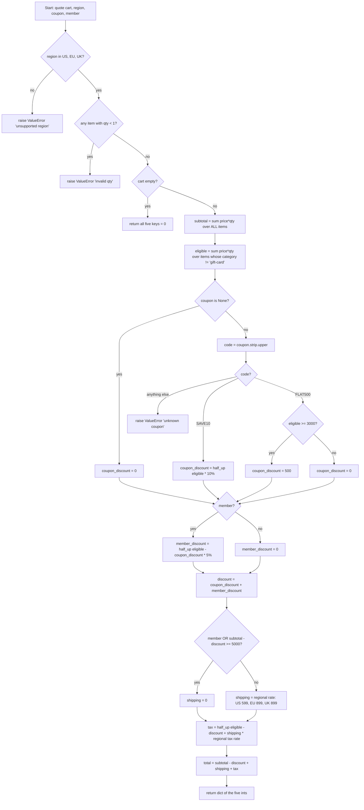

# Implementation Plan: `pricing.py`: `quote()`

## 1. Goal

Create a Python module `pricing.py` that exposes one public function:

```python
quote(cart, region, coupon=None, member=False) -> dict
```

It prices a shopping cart. It applies validation, coupons, a member discount, shipping and tax. All money is **integer cents**, both in and out.

## 2. Inputs and Output

### 2.1 Inputs

| Parameter | Type | Meaning |
|---|---|---|
| `cart` | `list[dict]` | List of items. May be empty. |
| `region` | `str` | One of `"US"`, `"EU"`, `"UK"`. |
| `coupon` | `str` or `None` | Optional coupon code. Defaults to `None`. |
| `member` | `bool` | Whether the customer is a member. Defaults to `False`. |

Each cart item is a dict with these keys:

| Key | Type | Meaning |
|---|---|---|
| `"sku"` | `str` | Item identifier. It is not used in any calculation. |
| `"price"` | `int` | Unit price in cents. |
| `"qty"` | `int` | Quantity. Must be at least 1. |
| `"category"` | `str` | Category. The value `"gift-card"` gets special treatment. |

### 2.2 Output

The function returns a `dict` with **exactly** these five keys and no others. Every value is a plain `int`: not `float`, not `Decimal`, not `bool`.

| Key | Meaning |
|---|---|
| `subtotal` | Sum of `price * qty` over all items, gift cards included. |
| `discount` | Coupon discount plus member discount. |
| `shipping` | Shipping charge. |
| `tax` | Tax charge. |
| `total` | `subtotal - discount + shipping + tax` |

## 3. Calculation Flow



## 4. Rules

### 4.1 Validation (runs first, in this order)

Validation runs before any other logic, including the empty-cart shortcut.

| Order | Check | Error raised |
|---|---|---|
| 1 | `region` is not exactly one of `"US"`, `"EU"`, `"UK"`. The comparison is case-sensitive, so `"us"` is invalid. | `ValueError("unsupported region")` |
| 2 | Any item in `cart` has `qty < 1`. Check every item. | `ValueError("invalid qty")` |

- When both errors apply, the region error wins because it is checked first.
- Error messages must match exactly: lowercase, no trailing punctuation.

### 4.2 Empty cart

| Condition | Result |
|---|---|
| `cart == []`, and validation passed | `{"subtotal": 0, "discount": 0, "shipping": 0, "tax": 0, "total": 0}` |

The coupon is **not** evaluated for an empty cart. An empty cart with `coupon="BOGUS"` returns all zeros. See Open Question Q1.

### 4.3 Subtotal and eligible amount

| Quantity | Formula |
|---|---|
| `subtotal` | Σ `price * qty` over **all** items |
| `eligible` | Σ `price * qty` over items where `category != "gift-card"` |

Gift cards count toward `subtotal`, so they also count toward the free-shipping threshold. They are never discounted and never taxed. The comparison against `"gift-card"` is exact.

### 4.4 Coupons

First normalise the code: `code = coupon.strip().upper()`. This makes matching case-insensitive and ignores surrounding whitespace.

| Normalised code | Condition | `coupon_discount` |
|---|---|---|
| `coupon is None` | n/a | `0` |
| `"SAVE10"` | always | `half_up(eligible × 10 / 100)` |
| `"FLAT500"` | `eligible >= 3000` | `500` |
| `"FLAT500"` | `eligible < 3000` | `0` (no error) |
| anything else, including `""` from an empty or whitespace-only string | n/a | raise `ValueError("unknown coupon")` |

The FLAT500 threshold uses `eligible`, not `subtotal`. Gift cards do not help a cart qualify.

### 4.5 Member discount

| `member` | `member_discount` |
|---|---|
| `True` | `half_up((eligible - coupon_discount) × 5 / 100)` |
| `False` | `0` |

The returned value is `discount = coupon_discount + member_discount`.

### 4.6 Shipping

Evaluate the rows top to bottom. The first match wins.

| Condition | `shipping` |
|---|---|
| `member` is `True` | `0` |
| `subtotal - discount >= 5000`. This uses `subtotal`, which includes gift cards, and the boundary is inclusive. | `0` |
| otherwise, region `US` | `599` |
| otherwise, region `EU` | `899` |
| otherwise, region `UK` | `899` |

### 4.7 Tax

| Region | Rate |
|---|---|
| US | 7 % |
| EU | 20 % |
| UK | 20 % |

The tax calculation:

- `tax_base = eligible - discount + shipping`. Gift cards are excluded and shipping is included.
- `tax = half_up(tax_base × rate / 100)`.

### 4.8 Rounding

Round every percentage result **half up** to a whole cent at the moment you compute it. Never round at the end. This applies to three values:

1. The SAVE10 discount.
2. The member discount.
3. The tax.

Do **not** use Python's built-in `round()`. It uses banker's rounding: `round(234.5) == 234`, but we need `235`. Do **not** use floats.

Implement the helper with integer math:

```
pct_half_up(amount, pct) = (amount * pct + 50) // 100
```

This formula is correct for `amount >= 0`. Every amount fed to it is non-negative when prices are non-negative. If you want robustness against negative prices, which are not validated, you can use `decimal.Decimal` with `ROUND_HALF_UP` instead. Either way, return an `int`.

### 4.9 Total

`total = subtotal - discount + shipping + tax`

## 5. Implementation Steps

1. **Constants.** Define these at module level:
   - `SHIPPING = {"US": 599, "EU": 899, "UK": 899}`
   - `TAX_PCT = {"US": 7, "EU": 20, "UK": 20}`
   - `FREE_SHIPPING_THRESHOLD = 5000`
   - `FLAT500_MIN = 3000`
   - `FLAT500_AMOUNT = 500`
   - `SAVE10_PCT = 10`
   - `MEMBER_PCT = 5`
   - `GIFT_CARD = "gift-card"`
2. **Helper.** Write a private `_pct_half_up(amount: int, pct: int) -> int` as specified in section 4.8.
3. **Validate the region.** If `region not in SHIPPING`, raise `ValueError("unsupported region")`.
4. **Validate quantities.** Loop over all items. If any `item["qty"] < 1`, raise `ValueError("invalid qty")`.
5. **Empty cart.** If `not cart`, return the five keys, each set to `0`.
6. **Compute amounts.** Compute `subtotal` and `eligible` as in section 4.3.
7. **Coupon.** Compute `coupon_discount` as in section 4.4. An unknown code raises here.
8. **Member discount.** Compute `member_discount` as in section 4.5, then set `discount = coupon_discount + member_discount`.
9. **Shipping.** Compute `shipping` as in section 4.6.
10. **Tax.** Compute `tax` as in section 4.7.
11. **Total.** Compute `total` and return `{"subtotal", "discount", "shipping", "tax", "total"}` with int values.
12. **Tests.** Write unit tests covering every worked example in section 6, plus the edge cases in section 7.

## 6. Worked Examples

### Example 1: Basic US order, no coupon, not a member

- Inputs: `cart = [{"sku": "A", "price": 1000, "qty": 2, "category": "books"}]`, `region = "US"`.
- Amounts: `subtotal = 2000`, `eligible = 2000`.
- Discount: `discount = 0`.
- Shipping: 2000 < 5000, so `shipping = 599`.
- Tax: `(2000 - 0 + 599) × 7% = 181.93`, which rounds to `182`.
- Total: `2000 - 0 + 599 + 182 = 2781`.

**Result:** `{subtotal: 2000, discount: 0, shipping: 599, tax: 182, total: 2781}`

### Example 2: SAVE10 and member in the EU, with a gift card (half-up matters)

- Cart: `[{"sku":"T","price":2345,"qty":1,"category":"toys"}, {"sku":"G","price":5000,"qty":1,"category":"gift-card"}]`
- Inputs: `region = "EU"`, `coupon = "SAVE10"`, `member = True`.
- Amounts: `subtotal = 7345`, `eligible = 2345`.
- Coupon: `2345 × 10% = 234.5`, which rounds to **235**. Built-in `round()` would wrongly give 234.
- Member discount: `(2345 - 235) × 5% = 2110 × 5% = 105.5`, which rounds to **106**.
- Discount: `235 + 106 = 341`.
- Shipping: the customer is a member, so `shipping = 0`.
- Tax: `(2345 - 341 + 0) × 20% = 2004 × 20% = 400.8`, which rounds to `401`.
- Total: `7345 - 341 + 0 + 401 = 7405`.

**Result:** `{subtotal: 7345, discount: 341, shipping: 0, tax: 401, total: 7405}`

### Example 3: FLAT500 below the threshold, messy code formatting, UK

- Inputs: `cart = [{"sku":"H","price":2999,"qty":1,"category":"home"}]`, `region = "UK"`, `coupon = "  flat500 "`.
- Coupon: the code normalises to `FLAT500`. Eligible is 2999, which is below 3000, so the coupon discount is `0` and no error is raised.
- Amounts and discount: `subtotal = 2999`, `discount = 0`.
- Shipping: 2999 < 5000, so `shipping = 899`.
- Tax: `(2999 + 899) × 20% = 3898 × 20% = 779.6`, which rounds to `780`.
- Total: `2999 + 899 + 780 = 4678`.

**Result:** `{subtotal: 2999, discount: 0, shipping: 899, tax: 780, total: 4678}`

### Example 4: FLAT500 applies and shipping becomes free, US

- Inputs: `cart = [{"sku":"B","price":1500,"qty":4,"category":"books"}]`, `region = "US"`, `coupon = "FLAT500"`.
- Amounts: `subtotal = 6000`, `eligible = 6000`.
- Coupon: 6000 ≥ 3000, so `discount = 500`.
- Shipping: `6000 - 500 = 5500`, which is ≥ 5000, so `shipping = 0`.
- Tax: `5500 × 7% = 385`.
- Total: `6000 - 500 + 0 + 385 = 5885`.

**Result:** `{subtotal: 6000, discount: 500, shipping: 0, tax: 385, total: 5885}`

### Example 5: A gift card pushes the order to the free-shipping threshold exactly, US

- Cart: `[{"sku":"G","price":4000,"qty":1,"category":"gift-card"}, {"sku":"B","price":1000,"qty":1,"category":"books"}]`
- Input: `region = "US"`.
- Amounts: `subtotal = 5000`, `eligible = 1000`, `discount = 0`.
- Shipping: `5000 - 0 = 5000`, which is ≥ 5000 (inclusive), so `shipping = 0`.
- Tax: `(1000 - 0 + 0) × 7% = 70`. The gift card is not taxed.
- Total: `5000 + 0 + 70 = 5070`.

**Result:** `{subtotal: 5000, discount: 0, shipping: 0, tax: 70, total: 5070}`

### Example 6: Gift cards only, with SAVE10, US

- Inputs: `cart = [{"sku":"G","price":2000,"qty":1,"category":"gift-card"}]`, `region = "US"`, `coupon = "save10"`.
- Amounts: `subtotal = 2000`, `eligible = 0`.
- Coupon: `0 × 10% = 0`, so `discount = 0`.
- Shipping: 2000 < 5000, so `shipping = 599`.
- Tax: `(0 - 0 + 599) × 7% = 41.93`, which rounds to `42`. Shipping is still taxed.
- Total: `2000 + 599 + 42 = 2641`.

**Result:** `{subtotal: 2000, discount: 0, shipping: 599, tax: 42, total: 2641}`

### Example 7: Tax lands on exactly .5, US

- Inputs: `cart = [{"sku":"C","price":951,"qty":1,"category":"crafts"}]`, `region = "US"`.
- Amounts: `subtotal = 951`, `discount = 0`.
- Shipping: `shipping = 599`.
- Tax: `(951 + 599) × 7% = 1550 × 7% = 108.5`, which rounds to **109**. Built-in `round()` would give 108.
- Total: `951 + 599 + 109 = 1659`.

**Result:** `{subtotal: 951, discount: 0, shipping: 599, tax: 109, total: 1659}`

### Example 8: Member plus FLAT500 at the threshold boundary, UK

- Inputs: `cart = [{"sku":"K","price":1000,"qty":3,"category":"kitchen"}]`, `region = "UK"`, `coupon = "FLAT500"`, `member = True`.
- Amounts: `subtotal = 3000`, `eligible = 3000`.
- Coupon: 3000 ≥ 3000, so the coupon discount is `500`.
- Member discount: `(3000 - 500) × 5% = 125`.
- Discount: `500 + 125 = 625`.
- Shipping: the customer is a member, so `shipping = 0`.
- Tax: `(3000 - 625 + 0) × 20% = 2375 × 20% = 475`.
- Total: `3000 - 625 + 0 + 475 = 2850`.

**Result:** `{subtotal: 3000, discount: 625, shipping: 0, tax: 475, total: 2850}`

### Example 9: Errors and empty carts

| Call | Outcome |
|---|---|
| `quote([], "US")` | all five keys `0` |
| `quote([], "FR")` | `ValueError("unsupported region")` |
| `quote([], "us")` | `ValueError("unsupported region")`, because the region check is case-sensitive |
| `quote([{"sku":"A","price":100,"qty":0,"category":"x"}], "US")` | `ValueError("invalid qty")` |
| `quote([{"sku":"A","price":100,"qty":-2,"category":"x"}], "EU")` | `ValueError("invalid qty")` |
| `quote([{"sku":"A","price":100,"qty":0,"category":"x"}], "CA")` | `ValueError("unsupported region")`, because the region is checked first |
| `quote([{"sku":"A","price":100,"qty":1,"category":"x"}], "US", coupon="BOGUS")` | `ValueError("unknown coupon")` |
| `quote([{"sku":"A","price":100,"qty":1,"category":"x"}], "US", coupon="   ")` | `ValueError("unknown coupon")` |
| `quote([], "US", coupon="BOGUS")` | all five keys `0`. The coupon is not evaluated for an empty cart (see Q1). |

## 7. Edge Cases Checklist for Tests

- [ ] Coupon codes in mixed case with leading or trailing whitespace or tabs, such as `" Save10\t"`, are accepted.
- [ ] `FLAT500` at an eligible amount of exactly 3000 applies; at 2999 it gives 0.
- [ ] Gift cards do not count toward the FLAT500 threshold.
- [ ] Free shipping applies at `subtotal - discount` of exactly 5000. At 4999, the regional rate is charged.
- [ ] Members always get free shipping, even on small orders.
- [ ] SAVE10, the member discount and tax each round half up on an exact `.5`.
- [ ] The member discount is calculated on the amount *after* the coupon, not on the original eligible amount.
- [ ] A gift-card-only cart is taxed only on its shipping.
- [ ] The returned dict has exactly five keys and every value is `int`.
- [ ] Every item is checked for qty, not just the first.

## 8. Open Questions for the Product Manager

The plan above implements the defaults stated here; confirm each with the PM.

- **Q1:** Should an unknown coupon on an empty cart raise an error? The requirements list only the region and qty checks as up-front validation, and say "after validation, an empty cart returns all five values as 0". The plan therefore returns zeros without evaluating the coupon.
- **Q2:** Should an empty-string or whitespace-only coupon count as "no coupon"? The plan treats only `None` as no coupon, so these raise `"unknown coupon"`.
- **Q3:** Should the region match case-insensitively? The plan uses an exact, case-sensitive match.
- **Q4:** Should negative prices or non-int types be validated? The plan does not validate them, beyond the `qty < 1` check.