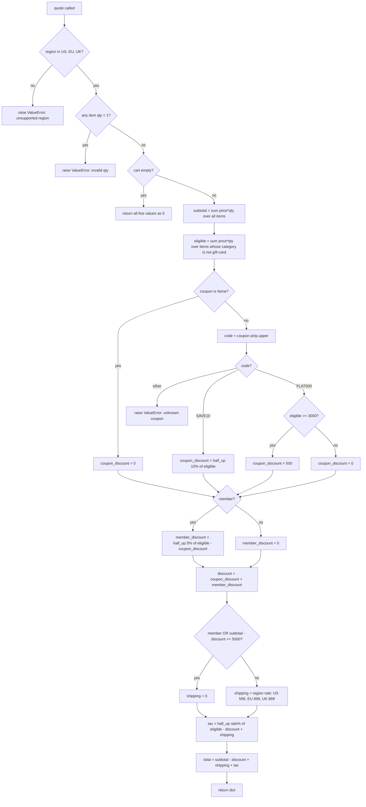

# Implementation Plan: `pricing.py`

## 1. Goal

Create a Python module `pricing.py` that exposes one public function:

```python
quote(cart, region, coupon=None, member=False) -> dict
```

It computes a price quote for a shopping cart. All money values, both input and output, are **integer cents**. Floats must never be used for money.

## 2. Inputs and Output

### 2.1 Parameters

| Parameter | Type | Meaning |
|---|---|---|
| `cart` | `list[dict]` | Items in the cart. May be empty. |
| `region` | `str` | Must be exactly `"US"`, `"EU"` or `"UK"`. |
| `coupon` | `str` or `None` | Optional coupon code. `None` means no coupon. |
| `member` | `bool` | Whether the customer is a member. Defaults to `False`. |

Each cart item is a dict with these keys:

| Key | Type | Meaning |
|---|---|---|
| `"sku"` | `str` | Item identifier. It does not affect pricing. |
| `"price"` | `int` | Unit price in cents. |
| `"qty"` | `int` | Quantity. Must be at least 1. |
| `"category"` | `str` | Category. The value `"gift-card"` has special rules. |

### 2.2 Return value

A `dict` with **exactly** these five keys. Every value is an `int`, in cents:

| Key | Meaning |
|---|---|
| `subtotal` | Sum of `price * qty` over all items, including gift cards. |
| `discount` | Coupon discount plus member discount. |
| `shipping` | Shipping charge. |
| `tax` | Tax charge. |
| `total` | `subtotal - discount + shipping + tax` |

Do not add any other keys.

## 3. Calculation Flow



## 4. Rules

### 4.1 Validation

Validation runs before anything else, in this order. The first failing check raises its error.

| Order | Check | Error raised |
|---|---|---|
| 1 | `region` is not one of `"US"`, `"EU"`, `"UK"` | `ValueError("unsupported region")` |
| 2 | Any item has `qty < 1`, for example 0 or a negative number | `ValueError("invalid qty")` |

Notes:
- The region comparison is exact and case-sensitive. `"us"` and `" US"` are both unsupported. Only coupon codes are case-insensitive.
- If both the region and a qty are invalid, raise the region error.
- Check every item for an invalid qty before computing anything.

### 4.2 Empty cart

After validation passes, if `cart` is empty, return:

```python
{"subtotal": 0, "discount": 0, "shipping": 0, "tax": 0, "total": 0}
```

This return happens before the coupon is examined, so an empty cart with an unrecognized coupon returns zeros and does not raise. See the open question in §8.

### 4.3 Subtotal and eligible amount

| Value | Definition |
|---|---|
| `subtotal` | Σ `price * qty` over **all** items |
| `eligible` | Σ `price * qty` over items whose `category != "gift-card"` |

Gift cards count toward `subtotal`, but they are never discounted and never taxed. The category match is exact: only the string `"gift-card"` counts as a gift card.

### 4.4 Coupons

First normalize the code: `code = coupon.strip().upper()`. Do this only when `coupon is not None`.

| Normalized code | Condition | `coupon_discount` |
|---|---|---|
| (coupon is `None`) | none | `0` |
| `"SAVE10"` | always | `half_up(eligible * 10 / 100)` |
| `"FLAT500"` | `eligible >= 3000` | `500` |
| `"FLAT500"` | `eligible < 3000` | `0` |
| anything else, including `""` | none | raise `ValueError("unknown coupon")` |

Examples of valid inputs: `"save10"`, `"  Flat500 "`, `"SaVe10\n"`.

### 4.5 Member discount

| `member` | `member_discount` |
|---|---|
| `True` | `half_up((eligible - coupon_discount) * 5 / 100)` |
| `False` | `0` |

The member discount is applied after the coupon:

`discount = coupon_discount + member_discount`

### 4.6 Shipping

Evaluate the rows top to bottom and use the first row that matches:

| Condition | `shipping` |
|---|---|
| `member` is `True` | `0` |
| `subtotal - discount >= 5000` | `0` |
| region `"US"` | `599` |
| region `"EU"` | `899` |
| region `"UK"` | `899` |

The threshold check uses `subtotal`, which includes gift cards, not `eligible`. The threshold is inclusive, so exactly 5000 qualifies for free shipping.

### 4.7 Tax

`taxable = eligible - discount + shipping`

| Region | Rate | `tax` |
|---|---|---|
| `"US"` | 7% | `half_up(taxable * 7 / 100)` |
| `"EU"` | 20% | `half_up(taxable * 20 / 100)` |
| `"UK"` | 20% | `half_up(taxable * 20 / 100)` |

Shipping is part of the taxable amount. Gift cards are excluded because they are not in `eligible`.

### 4.8 Total

`total = subtotal - discount + shipping + tax`

### 4.9 Rounding

- Every percentage result is rounded **half up** to a whole cent at the moment it is computed. This applies to the SAVE10 discount, the member discount and the tax.
- Each result is rounded individually, never at the end.
- Do **not** use Python's `round()`. It uses banker's rounding, so `round(102.5)` returns `102`, but half up must return `103`.
- Do not use floats. Use integer arithmetic. Every input amount is non-negative, so this works:

  ```text
  percent_half_up(amount, pct) = (amount * pct + 50) // 100
  ```

  Using `decimal.Decimal` with `ROUND_HALF_UP` is also acceptable.

## 5. Implementation Steps

1. Create `pricing.py`. Define module-level constants:
   - `REGIONS = {"US", "EU", "UK"}`
   - `SHIPPING = {"US": 599, "EU": 899, "UK": 899}`
   - `TAX_PCT = {"US": 7, "EU": 20, "UK": 20}`
   - `FREE_SHIPPING_THRESHOLD = 5000`
   - `FLAT500_MIN = 3000`
   - `GIFT_CARD = "gift-card"`
2. Add a private helper `_pct_half_up(amount: int, pct: int) -> int` that returns `(amount * pct + 50) // 100`.
3. In `quote`, validate the region (§4.1, order 1).
4. Loop over all items and validate qty (§4.1, order 2).
5. If `cart` is empty, return the all-zero dict (§4.2).
6. Compute `subtotal` and `eligible` (§4.3).
7. Compute `coupon_discount` (§4.4). Raise on an unknown code.
8. Compute `member_discount` and `discount` (§4.5).
9. Compute `shipping` (§4.6).
10. Compute `tax` (§4.7).
11. Compute `total` (§4.8). Return the dict with exactly the five keys.
12. Write tests that cover every worked example in §6 and every case in §7.

## 6. Worked Examples

### Example 1: Basic US order, below the free-shipping threshold
`cart=[{"sku":"A","price":1000,"qty":2,"category":"books"}]`, `region="US"`

| Step | Value |
|---|---|
| subtotal | 2000 |
| eligible | 2000 |
| discount | 0 |
| shipping | 2000 < 5000, so 599 |
| tax | 7% of 2599 = 181.93, rounded to **182** |
| total | 2000 − 0 + 599 + 182 = **2781** |

Result: `{subtotal: 2000, discount: 0, shipping: 599, tax: 182, total: 2781}`

### Example 2: EU, SAVE10 and member, with a gift card
`cart=[{"sku":"T","price":1299,"qty":3,"category":"toys"}, {"sku":"G","price":2500,"qty":1,"category":"gift-card"}]`, `region="EU"`, `coupon="SAVE10"`, `member=True`

| Step | Value |
|---|---|
| subtotal | 3897 + 2500 = 6397 |
| eligible | 3897 |
| coupon_discount | 10% of 3897 = 389.7, rounded to 390 |
| member_discount | 5% of (3897 − 390 = 3507) = 175.35, rounded to 175 |
| discount | 565 |
| shipping | member, so 0 |
| tax | 20% of (3897 − 565 + 0 = 3332) = 666.4, rounded to **666** |
| total | 6397 − 565 + 0 + 666 = **6498** |

### Example 3: FLAT500 exactly at the threshold, UK
`cart=[{"sku":"H","price":3000,"qty":1,"category":"home"}]`, `region="UK"`, `coupon="FLAT500"`

| Step | Value |
|---|---|
| subtotal / eligible | 3000 / 3000 |
| coupon_discount | 3000 ≥ 3000, so 500 |
| discount | 500 |
| shipping | 3000 − 500 = 2500 < 5000, so 899 |
| tax | 20% of (2500 + 899 = 3399) = 679.8, rounded to **680** |
| total | 3000 − 500 + 899 + 680 = **4079** |

### Example 4: FLAT500 below the threshold, messy code, gift card triggers free shipping
`cart=[{"sku":"V","price":2999,"qty":1,"category":"games"}, {"sku":"G","price":5000,"qty":1,"category":"gift-card"}]`, `region="US"`, `coupon="  flat500 "`

| Step | Value |
|---|---|
| subtotal | 7999 |
| eligible | 2999 |
| coupon_discount | 2999 < 3000, so 0 |
| discount | 0 |
| shipping | 7999 − 0 ≥ 5000, so 0 |
| tax | 7% of 2999 = 209.93, rounded to **210** |
| total | 7999 − 0 + 0 + 210 = **8209** |

### Example 5: Half-up tie on SAVE10, where `round()` would be wrong
`cart=[{"sku":"M","price":1025,"qty":1,"category":"misc"}]`, `region="US"`, `coupon="save10"`

| Step | Value |
|---|---|
| subtotal / eligible | 1025 / 1025 |
| coupon_discount | 10% of 1025 = 102.5, rounded half up to **103** (`round()` would give 102) |
| discount | 103 |
| shipping | 922 < 5000, so 599 |
| tax | 7% of (1025 − 103 + 599 = 1521) = 106.47, rounded to 106 |
| total | 1025 − 103 + 599 + 106 = **1627** |

### Example 6: Half-up tie on the member discount
`cart=[{"sku":"S","price":505,"qty":2,"category":"socks"}]`, `region="EU"`, `member=True`

| Step | Value |
|---|---|
| subtotal / eligible | 1010 / 1010 |
| member_discount | 5% of 1010 = 50.5, rounded half up to **51** (`round()` would give 50) |
| discount | 51 |
| shipping | member, so 0 |
| tax | 20% of 959 = 191.8, rounded to 192 |
| total | 1010 − 51 + 0 + 192 = **1151** |

### Example 7: Cart with only gift cards
`cart=[{"sku":"G","price":2000,"qty":1,"category":"gift-card"}]`, `region="UK"`, `coupon="SAVE10"`

| Step | Value |
|---|---|
| subtotal / eligible | 2000 / 0 |
| coupon_discount | 10% of 0 = 0 |
| discount | 0 |
| shipping | 2000 < 5000, not a member, so 899 |
| tax | 20% of (0 − 0 + 899) = 179.8, rounded to 180. Shipping is still taxed. |
| total | 2000 + 899 + 180 = **3079** |

### Example 8: Free-shipping threshold is inclusive
`cart=[{"sku":"B","price":2500,"qty":2,"category":"books"}]`, `region="US"`

subtotal 5000, discount 0, so 5000 ≥ 5000 and shipping is 0. tax = 7% of 5000 = 350. total = **5350**.

## 7. Error and Edge Cases (must be tested)

| Input | Expected |
|---|---|
| `region="CA"` | `ValueError("unsupported region")` |
| `region="us"` | `ValueError("unsupported region")` |
| `region="CA"` and an item with `qty=0` | `ValueError("unsupported region")`, because region is checked first |
| item with `qty=0` | `ValueError("invalid qty")` |
| item with `qty=-2` | `ValueError("invalid qty")` |
| valid region, invalid qty, `coupon="BOGUS"` | `ValueError("invalid qty")` |
| `cart=[]`, valid region | all five values `0` |
| `cart=[]`, `member=True` | all five values `0`. There is no shipping on an empty cart. |
| non-empty cart, `coupon="BOGUS"` | `ValueError("unknown coupon")` |
| non-empty cart, `coupon=""` or `"   "` | `ValueError("unknown coupon")` |
| non-empty cart, `coupon=None` | no coupon discount |
| `coupon=" Save10 "` | treated as `SAVE10` |
| eligible = 2999 with FLAT500 | coupon discount 0, no error |
| `subtotal - discount = 4999`, not a member | shipping charged |
| result dict | has exactly the keys `subtotal`, `discount`, `shipping`, `tax`, `total`, and all values are `int` |

## 8. Open Questions for the Product Manager

The plan uses the interpretations below. Implement them as written unless the product manager says otherwise.

1. **Empty cart with an unknown coupon.** Validation only covers region and qty, and the empty-cart return comes before coupon handling. So `quote([], "US", "BOGUS")` returns zeros and does not raise.
2. **Empty-string coupon.** Only `None` means "no coupon". An empty or whitespace-only string raises `"unknown coupon"`.
3. **Gift-card-only carts.** These carts are charged shipping and pay tax on that shipping, as shown in Example 7.