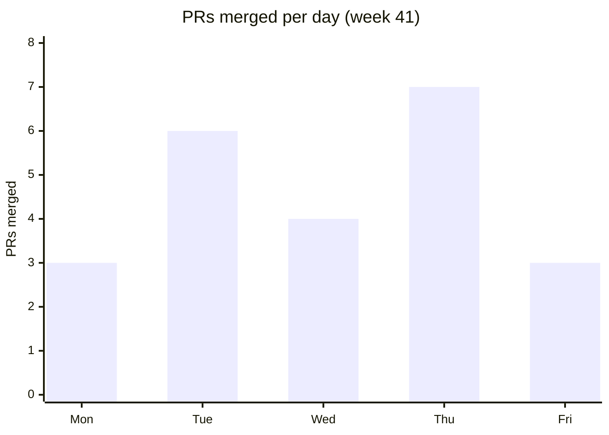

# Weekly Engineering Status: Team Checkout, Week 41

## Headline Numbers

| Metric | Value |
| --- | --- |
| PRs merged | 23 |
| Incidents | 2 |
| p95 checkout latency | 412 ms (was 530 ms) |
| Test coverage | 78% |

## PRs Merged per Day

| Day | PRs merged |
| --- | ---: |
| Mon | 3 |
| Tue | 6 |
| Wed | 4 |
| Thu | 7 |
| Fri | 3 |
| **Total** | **23** |

## Work Items

| ID | Item | Owner | Status | Note |
| --- | --- | --- | --- | --- |
| CHK-101 | Apple Pay button | frontend | ✅ Done | Shipped behind flag |
| CHK-102 | Address autocomplete | frontend | 🔄 In progress | Waiting on API quota |
| CHK-103 | Retry queue for payment webhooks | backend | ✅ Done | Cut duplicate charges to zero in staging |
| CHK-104 | Fraud score threshold tuning | data | ⛔ Blocked | Needs legal sign-off |
| CHK-105 | Cart service p95 latency | backend | ✅ Done | 530 ms to 412 ms |
| CHK-106 | Guest checkout A/B test | product | 🔄 In progress | 40% of traffic enrolled |

**Summary:** 3 done, 2 in progress, 1 blocked.

## Risks

1. **Fraud tuning blocked on legal.** This could slip the November release.
2. **Autocomplete API quota resets monthly.** A spike would disable the feature.

## Next Week

- Finish address autocomplete.
- Get legal's answer on fraud thresholds.
- Read out the guest checkout A/B test results.